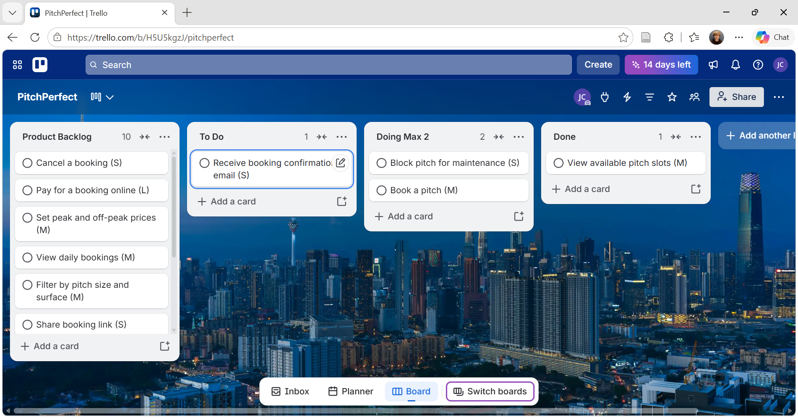

## Task 1

Backlog:
1. View available pitch slots (M)
2. Book a pitch (M)
3. Block pitch for maintenance (S)
4. View daily bookings (M)
5. Cancel a booking (S)
6. Booking confirmation email (S)
7. Pay online (L)
8. Set peak and off-peak prices (M)
9. Filter by pitch size and surface (M)
10. Share booking link (S)
11. Booking reminder (S)
12. View past bookings (M)
13. Export monthly reports (M)
14. Rate pitch condition (S)

Sprint goal was to allow players to view and book available pitches with support for maintenance blocks and booking confirmations

Only 2 tasks can be in progress at a time

Done: View available pitch slots 

Next: Working on booking a pitch and blocking pitches for maintenance.

Blockers: The booking system needs to check available time slots to avoid double booking

What went well: Was able to organize the tasks and keep track of what was finished and what still needed to be done.

What didnt go well: I selected four user stories for the sprint but only moved one to done leaving two in progress and one in To Do.

What i would do next time:  Plan the sprint better and choose tasks based on how much work they would take

## Task 2 

1. As a student I want to view my weekly timetable so that I know when my classes are on.
2. As a student I want to see the room and lecturer for each class so that I know where to go.
3. As a student I want to be notified if a class is cancelled or moved so that I dont miss any changes.
4. As a student I want to request a change to my lab or lecture time so that i can avoid clashes with other commitments.
5. As a student I want to add my timetable to my phone so that I can keep track of my classes.
6. As a lecturer I want to mark a class as cancelled or moved so that students know about changes.
7. As an administrator I want to see which classes are over capacity so that I can sort out any room issues.

Acceptance Criteria for story 1:
Students can see all their classes for the week
Each class shows the correct day and time
Students only see classes they are enrolled in.

Acceptance Criteria for story 3:
Students receive a notification if a class is cancelled
Students receive a notification if the time or room changes
The notification shows the updated class information

## Task 3
Continuous Integration is when developers regularly add their code to a shared project and run tests to check for problems. Visual studio code uses automated testing when changes are made to its code, which would be useful for the PitchPerfect project because the team would check their work as tasks move through the Kanban board. It would help catch mistakes and make it easier to work on the same project.

